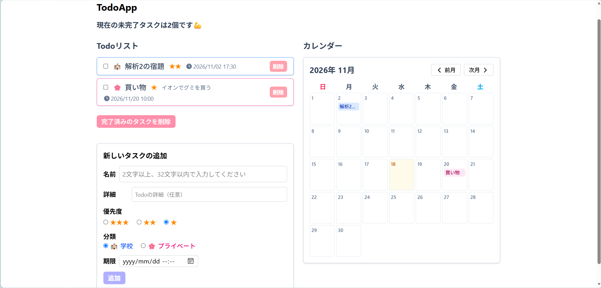
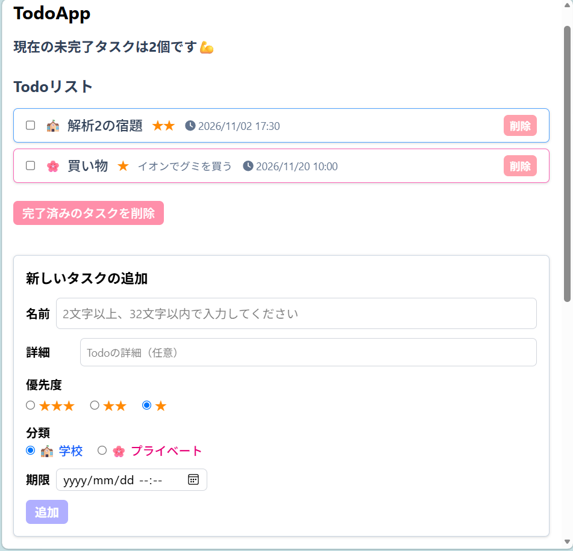

# TodoApp

eact、TypeScript、Tailwind CSS を使用し、タスク一覧とカレンダーを同時に確認できる学習・生活管理向け Todo アプリです。データの永続化（LocalStorage）に対応しています。

---

## デプロイ（公開URL）

https://mi43-a.github.io/react-todo-app/

---

## 📸 アプリ画面（スクリーンショット）

| 1. 全体画面（2カラム表示） | 2. タスク追加フォーム |
| :---: | :---: |
|  
|  
|  

| 2. タスク追加フォーム |

| 3. 学校・プライベート色分け | 4. カレンダー色分け表示 | 5. レスポンシブ表示（スマホ） |
| :---: | :---: | :---: |
|  |  |  |

---

## ⏰開発履歴

- 2026年10月16日：プロジェクト開始
- 2026年11月18日：最新編集日
- (約18時間)

---

## 📃ライセンス

MIT License

Copyright (c) 2026 Hirayma Mia

Permission is hereby granted, free of charge, to any person obtaining a copy
of this software and associated documentation files (the "Software"), to deal
in the Software without restriction, including without limitation the rights
to use, copy, modify, merge, publish, distribute, sublicense, and/or sell
copies of the Software, and to permit persons to whom the Software is
furnished to do so, subject to the following conditions:

The above copyright notice and this permission notice shall be included in all
copies or substantial portions of the Software.

THE SOFTWARE IS PROVIDED "AS IS", WITHOUT WARRANTY OF ANY KIND, EXPRESS OR
IMPLIED, INCLUDING BUT NOT LIMITED TO THE WARRANTIES OF MERCHANTABILITY,
FITNESS FOR A PARTICULAR PURPOSE AND NONINFRINGEMENT. IN NO EVENT SHALL THE
AUTHORS OR COPYRIGHT HOLDERS BE LIABLE FOR ANY CLAIM, DAMAGES OR OTHER
LIABILITY, WHETHER IN AN ACTION OF CONTRACT, TORT OR OTHERWISE, ARISING FROM,
OUT OF OR IN CONNECTION WITH THE SOFTWARE OR THE USE OR OTHER DEALINGS IN THE
SOFTWARE.
