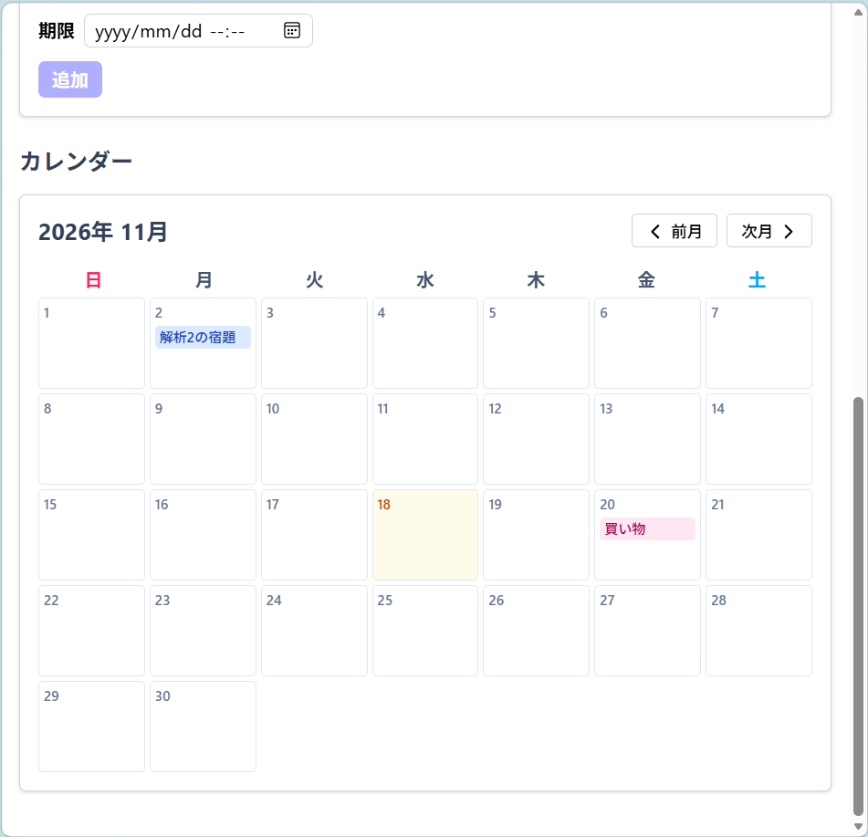
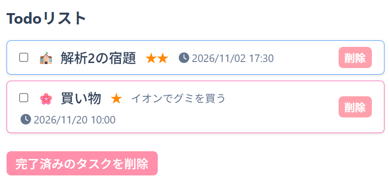
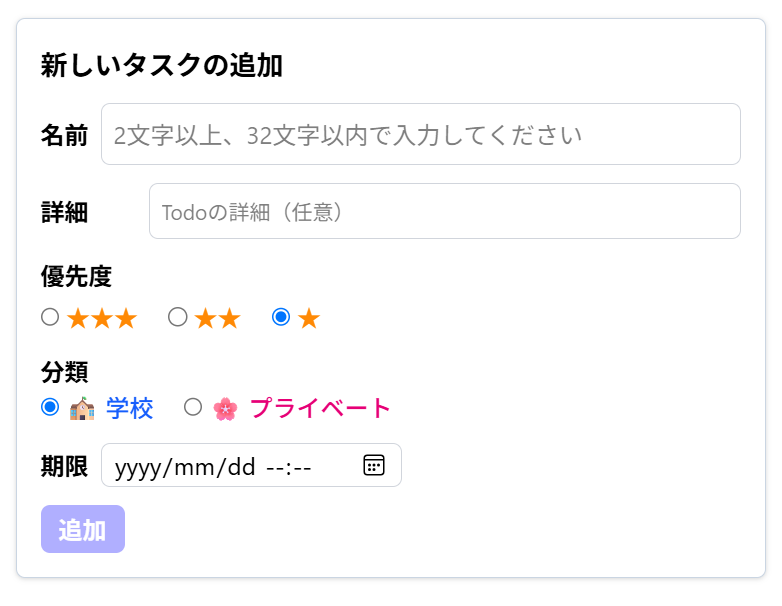
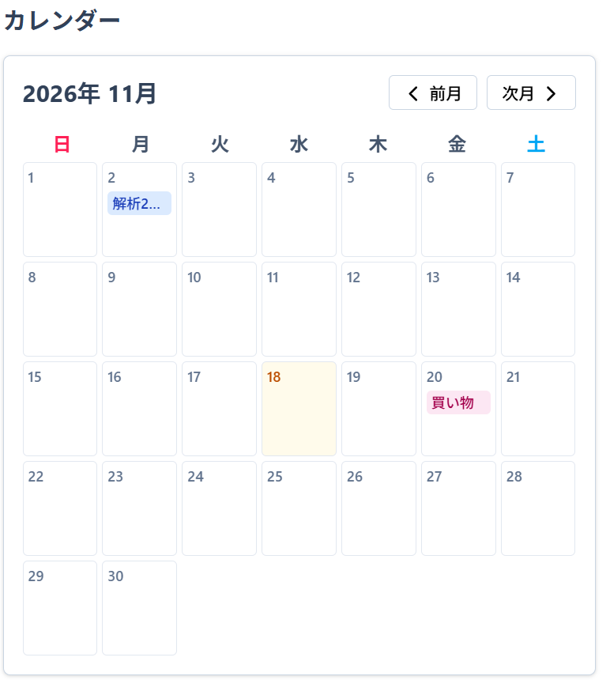

# TodoApp

eact、TypeScript、Tailwind CSS を使用し、タスク一覧とカレンダーを同時に確認できる学習・生活管理向け Todo アプリです。データの永続化（LocalStorage）に対応しています。

---

## 🔗デプロイ（公開URL）

https://mi43-a.github.io/react-todo-app/

---

## 📸 アプリ画面（スクリーンショット）

| 画面をPC全体にしたとき |
| :---: |
|  | 

| 画面をPCの半分にしたとき(上) | 画面をPCの半分にしたとき(下) |
| :---: | :---: |
|  |  

| Todoリスト | 新しいタスクの追加 | カレンダー |
| :---: | :---: | :---: |
|  |  |  |
---

## 🌟 アプリのコンセプト・開発背景

学校の課題とプライベートの予定を一つの画面で直感的に把握・整理したいという悩みや、こんな機能ほしいという私の理想から開発しました。
表示切り替え型では、わざわざ切り替えて見なくなるという経験があることから、PC画面上で「Todoリスト」と「月間カレンダー」を左右に配置することで、一目でスケジュールと優先度が把握できるように設計しているのが工夫した点です。
また、学校でのタスクなのか、プライベートのタスクなのかを分別し、一目でわかるようにした点も工夫した点です。

---

## ✨ 主な機能と特徴

1. **リストとカレンダーの同時表示**
   - 画面切り替えの手間を無くし、同じ画面でタスクの管理とスケジュールの確認が可能です。
   - レスポンシブ対応により、スマートフォン画面では自動的に上下配置に調整されます。

2. **カテゴリー分類（学校 🏫 / プライベート 🌸）**
   - ラジオボタンで分類を選択でき、タスクの枠線（学校: 青 / プライベート: ピンク）および絵文字で直感的に区別できます。
   - カレンダー上でも対応するカラーバッジとアイコンで表示されます。

3. **詳細（場所・メモ）の入力・表示**
   - タスクごとに「教室」「準備物」などの詳細メモを登録・確認できます。

4. **直感的な優先度表示（★★★〜★）**
   - フォーム側・リスト側ともに星マーク（★）で統一し、優先度（高・中・低）が視覚的にわかりやすくなっています。

5. **データの永続化（LocalStorage）**
   - ブラウザの LocalStorage を利用し、リロードやブラウザの再起動後もタスクデータが保持されます。

---

## 🛠️ 技術スタック・主要ライブラリ

- **フロントエンド**: React 19, TypeScript
- **ビルドツール**: Vite
- **スタイリング**: Tailwind CSS (v4)
- **ライブラリ**: 
  - `dayjs` (日時フォーマット・カレンダー計算)
  - `font-awesome` (UIアイコン)
  - `uuid` (ユニークID生成)
  - `tailwind-merge` (クラス結合)

---

## ⏰開発履歴

- 2026年10月16日：プロジェクト開始
- 2026年11月18日：最新編集日
- (約18時間)

---

## 📃ライセンス

MIT License

Copyright (c) 2026 Hirayma Mia

Permission is hereby granted, free of charge, to any person obtaining a copy
of this software and associated documentation files (the "Software"), to deal
in the Software without restriction, including without limitation the rights
to use, copy, modify, merge, publish, distribute, sublicense, and/or sell
copies of the Software, and to permit persons to whom the Software is
furnished to do so, subject to the following conditions:

The above copyright notice and this permission notice shall be included in all
copies or substantial portions of the Software.

THE SOFTWARE IS PROVIDED "AS IS", WITHOUT WARRANTY OF ANY KIND, EXPRESS OR
IMPLIED, INCLUDING BUT NOT LIMITED TO THE WARRANTIES OF MERCHANTABILITY,
FITNESS FOR A PARTICULAR PURPOSE AND NONINFRINGEMENT. IN NO EVENT SHALL THE
AUTHORS OR COPYRIGHT HOLDERS BE LIABLE FOR ANY CLAIM, DAMAGES OR OTHER
LIABILITY, WHETHER IN AN ACTION OF CONTRACT, TORT OR OTHERWISE, ARISING FROM,
OUT OF OR IN CONNECTION WITH THE SOFTWARE OR THE USE OR OTHER DEALINGS IN THE
SOFTWARE.
